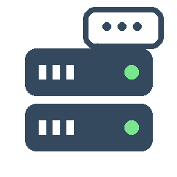
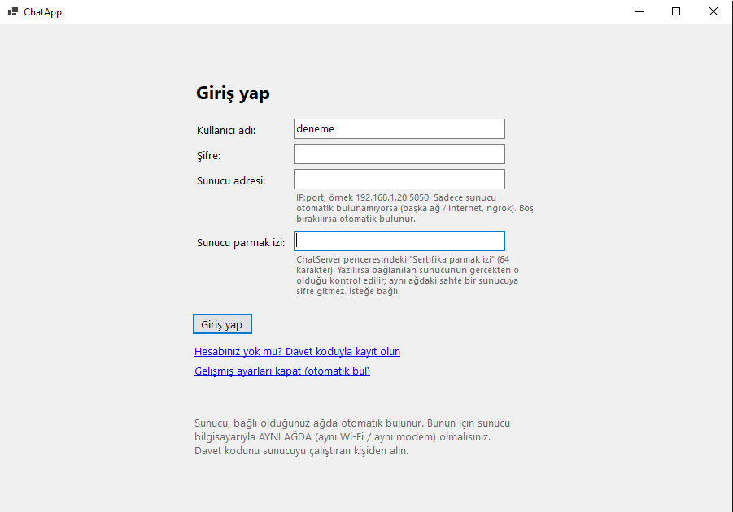
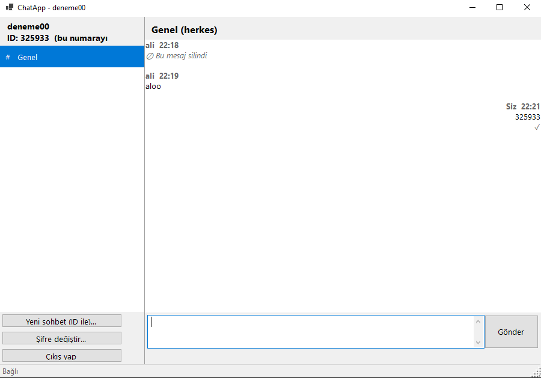

# ChatApp (İstemci-Sunucu Sohbet)

[](https://github.com/Ali-Istanbullu/YMH219-ChatApp/actions/workflows/ci.yml)

<p align="center">&nbsp;&nbsp;</p>

Yerel ağda çalışan, WhatsApp mantığında bir sohbet uygulaması: herkes **ChatApp.exe** ile bağlanır, karşısındakinin
6 haneli ID'siyle özel konuşur ya da herkesin bulunduğu **Genel** odaya yazar. Mesajlar, hesaplar ve yönetim
**ChatServer.exe**'de (PostgreSQL veritabanıyla) durur. Bağlantı TCP + TLS.
**YMH219 Nesne Tabanlı Programlama**, 3. uygulama ödevi.

**Ali İstanbullu, 250542019**

## Ekran Görüntüleri

| Giriş (Gelişmiş açık) | Sohbet (Genel oda) |
|---|---|
|  |  |

## Özellikler

**ChatApp (kullanıcılar)**
- Kayıt (tek kullanımlık davet koduyla), giriş, şifre değiştirme.
- Özel sohbet (ID ile) ve Genel oda. Çevrimiçi göstergesi, okundu bilgisi (✓ / ✓✓ / mavi ✓✓), engelleme.
- Mesajı "Benden sil" / "Herkesten sil", sohbeti sil. Geçmiş 100'er mesaj olarak yüklenir.
- Sunucuyu **kendisi bulur**: aynı ağdaki ChatServer'a UDP ile sorar; adres yazmak gerekmez.
  "Gelişmiş" altında istenirse sunucu adresi (başka ağ / ngrok) ve **sertifika parmak izi** elle yazılır.
- Bağlantı koparsa otomatik yeniden bağlanır (2, 4, 8… en fazla 30 sn). Gönderilemeyen mesajlar bağlantı gelince
  sırasıyla gönderilir, sunucu aynı mesajı iki kez kaydetmez.
- Pencere arka plandayken yeni mesajda görev çubuğu yanıp söner ve ses çalar.

**ChatServer (yönetici)**
- İlk açılışta **hazır veritabanını kendisi kurar** (PostgreSQL kurulumun içinde) ya da var olan bir PostgreSQL'e bağlanır.
- Bağlı kullanıcılar (at / yasakla), yasaklılar, davet kodu üretme, **mesaj kayıtları** (silinenler dahil, salt okunur),
  olay günlüğü.
- Mesaj tablosu 500 MB'ı geçince en eski mesajlar silinip 250 MB'a düşürülür (açılışta ve günde bir kez).

**Güvenlik:** TLS 1.2/1.3. Sunucu kendi sertifikasını üretir, istemci parmak izini ilk bağlantıda hatırlar ve
değişirse uyarır. İstenirse parmak izi ChatServer penceresinden alınıp
ChatApp'te elle yazılır; o zaman ilk bağlantıda da sunucunun gerçekten o olduğu kontrol edilir. Şifreler PBKDF2-SHA256 (600.000 tur) ile saklanır. 5 yanlış şifrede hesap 1 dk kilitlenir.
Mesaj, kayıt ve giriş için hız sınırı vardır. Veritabanı şifresi Windows DPAPI ile şifreli tutulur.

> Kayıt ekranında da yazdığı gibi: mesajlar sunucuda saklanır. Silinen mesajlar dahil, kötüye kullanım durumunda
> yönetici tarafından incelenebilir.

## Kurulum

[Releases](https://github.com/Ali-Istanbullu/YMH219-ChatApp/releases) sayfasından:

1. **Sunucu olacak tek bilgisayara** `ChatServer-Kurulum-1.0.0.exe`. İlk açılışta "Hazır veritabanını kur (önerilen)",
   sonra **Başlat**. Windows güvenlik duvarı izin isterse **Özel ağlar**'a izin verin.
2. ChatServer'da **Davet kodları → Üret**, kodu kullanıcıya verin.
3. **Kullanıcıların bilgisayarına** `ChatApp-Kurulum-1.0.0.exe`. Açınca sunucu otomatik bulunur. "Kayıt ol" ekranında
   davet kodunu girin. Daha güvenlisi: davet koduyla birlikte ChatServer'daki "Sertifika parmak izi"ni de verin,
   kullanıcı onu "Gelişmiş → Sunucu parmak izi" kutusuna yapıştırsın.

Bütün bilgisayarlar **aynı ağda** (aynı Wi-Fi/modem) olmalıdır. Sohbet için internet gerekmez.

### Gereksinimler

| | ChatApp | ChatServer |
|---|---|---|
| İşletim sistemi | Windows 10/11 x64 | Windows 10/11 x64 |
| .NET 10 Desktop Runtime | Yoksa kurulum indirip kurar | Yoksa kurulum indirip kurar |
| Visual C++ 2015-2022 (x64) | Gerekmez | Yoksa kurulum indirip kurar (PostgreSQL ister) |
| PostgreSQL 18 | Gerekmez | Kurulumun içinde (internet gerekmez) |
| İnternet | Sadece kurulumda, yukarıdakiler eksikse | Sadece kurulumda, yukarıdakiler eksikse |

Kaldırınca program dosyaları silinir. `%LocalAppData%\ChatServer` (veritabanı, ayarlar, sertifika, loglar) ve
`%LocalAppData%\ChatApp` **kalır**.

### Kaynak koddan

Windows x64, .NET SDK 10.0.401:

```
dotnet build
dotnet test tests/ChatApp.UnitTests
dotnet run --project src/ChatApp.Server.WinForms
dotnet run --project src/ChatApp.WinForms
```

Kaynaktan çalışırken ChatServer, hazır veritabanı için bilgisayarda kurulu PostgreSQL'in programlarını kullanır
(`C:\Program Files\PostgreSQL\<sürüm>\bin` ya da `CHATAPP_PG_BIN`). Kurulum dosyalarını üretmek için:
`installer\kurulumlari-olustur.ps1` (Inno Setup gerekir).

## Testler

| Proje | Ne test ediliyor | Sayı |
|---|---|---|
| `ChatApp.UnitTests` | Protokol, sunucu ve istemci mantığı (sahte depolarla), gerçek TLS ile uçtan uca | 179 |
| `ChatApp.SmokeTests` | Gerçek PostgreSQL ile depolar, hazır veritabanı kurulumu, iki exe açılıp kapanıyor mu | 21 |
| `ChatApp.PerformanceTests` | Aşağıdaki ölçümler | 4 |

PostgreSQL testleri `CHATAPP_TEST_DB` bağlantı dizesi yoksa atlanır. CI bunu GitHub'ın Windows sunucusunda kendisi kurar.

Performans (geliştirici bilgisayarı, Release):

| Ölçüm | Sonuç | Eşik |
|---|---|---|
| Genel oda: 20 kişi × 5 mesaj, herkes hepsini alır (1.900 teslim) | 201 ms | 5 sn |
| Özel mesaj, gönderme → karşıya ulaşma (medyan) | 15,2 ms | 100 ms |
| Şifre hash / doğrulama (600.000 tur) | 91 / 246 ms | 3 sn |
| PostgreSQL'de mesaj başına yer (10.000 mesaj, indeksler dahil) | 418 bayt (500 MB ≈ 1,25 milyon mesaj) | 1000 bayt |
| Özel geçmiş (100 mesaj) / sohbet listesi sorgusu | 6,4 / 8,4 ms | 100 ms |

## Teknolojiler

C# / .NET 10, Windows Forms, TCP (`TcpListener`/`TcpClient`) + TLS (`SslStream`), UDP yayını (sunucu bulma),
PostgreSQL 18. NuGet: Npgsql 10.0.3, Microsoft.Extensions.DependencyInjection 11.0.0, Serilog 4.4.0
(+ Sinks.File 7.0.0), MSTest 4.0.2. Inno Setup, GitHub Actions.

## Proje Yapısı

```
src/ChatApp.Protocol          Paketler (satır başına bir JSON), doğrulama kuralları, sunucu bulma protokolü
src/ChatApp.Server            Sunucu mantığı: TLS sunucu, oturumlar, servisler, PostgreSQL depoları, hazır veritabanı
src/ChatApp.Server.WinForms   ChatServer.exe: pencereler, DPAPI, log, DI
src/ChatApp.Client            İstemci mantığı: bağlantı, oturum, sohbet durumu, presenter
src/ChatApp.WinForms          ChatApp.exe: giriş ve sohbet panelleri, bildirim, log, DI
tests/...                     Birim, smoke, performans testleri
installer/                    Inno Setup betikleri, PostgreSQL paketini hazırlayan betik
.github/workflows             CI (her push'ta derle + test), Release (v* etiketiyle iki kurulum dosyası)
```

## Kod Sözlüğü

| Kod | Anlamı |
|---|---|
| `Paket`, `MesajGonder`, `MesajGeldi`, `GirisIstegi` … | Ağda giden paketler |
| `TcpSunucu`, `PaketIsleyici`, `OturumYoneticisi` | Bağlantıları kabul eder, paketi ilgili servise yönlendirir, kim bağlı tutar |
| `HesapServisi`, `MesajServisi`, `KisiServisi`, `YonetimServisi` | Kayıt/giriş, mesajlaşma, kişiler/engel, yönetici işlemleri |
| `SifreHashleyici`, `GirisKilidi`, `HizSinirlayici` | PBKDF2, yanlış şifre kilidi, hız sınırı |
| `Postgres*Deposu`, `DepoHatasi` | Veritabanı işlemleri, veritabanı hatası |
| `GomuluPostgres` | Hazır veritabanını kurar, başlatır, durdurur |
| `KesifYanitlayici`, `SunucuBulucu` | Sunucu bulma: sunucu tarafı, istemci tarafı |
| `SertifikaDeposu`, `ParmakIziDeposu` | Sunucu sertifikası, istemcinin hatırladığı parmak izleri |
| `SohbetIstemcisi`, `SohbetYoneticisi`, `SohbetDurumu` | İstemcide bağlantı, presenter, ekrandaki sohbetler |
| `MesajTemizleyici` | 500 MB → 250 MB temizliği |

## Sınırlamalar

- Sadece Windows x64. Sunucu ile kullanıcılar aynı yerel ağda olmalı. İnternet üzerinden bağlanmak için ngrok ya da
  modemde port yönlendirme gerekir (ChatApp'te "Gelişmiş" altına adres yazılır).
- **İlk bağlantıda sahte sunucu riski:** parmak izi elle yazılmazsa, aynı ağda biri sahte bir ChatServer çalıştırır ve
  ChatApp ilk kez ona denk gelirse, ChatApp onun parmak izini kaydeder ve kullanıcı şifresini ona girer. Sonraki
  bağlantılarda parmak izi kontrolü bunu yakalar, ilkinde yakalamaz. Parmak izi "Gelişmiş"te yazılırsa ilkinde de yakalar.
- ChatServer ve veritabanı aynı bilgisayarda, yöneticinin kendi Windows kullanıcısıyla çalışır. PostgreSQL sadece
  bu bilgisayardan (localhost) erişilebilir.
- Sunucunun IP adresi değişirse otomatik bulma yeni adresi bulur. Elle yazılmış adres varsa onun düzeltilmesi gerekir.
  IPv6 adres desteklenmez.
- Windows kullanıcı klasörü yolunda sistem dilinde olmayan karakter varsa hazır veritabanı kurulamayabilir. Hata mesajı
  bunu söyler; "Kendi PostgreSQL'imi kullanacağım" seçeneği kalır.
- Kurulum dosyaları imzasız. SmartScreen uyarısında "Ek bilgi → Yine de çalıştır".
- Dosya/resim gönderme, grup, hesap silme ve görünen ad değiştirme yok.

## Lisans

[MIT](LICENSE) © 2026 Ali İstanbullu. Kurulumdaki PostgreSQL kendi lisansıyla dağıtılır
([installer/ucuncu-taraf/PostgreSQL-LISANS.txt](installer/ucuncu-taraf/PostgreSQL-LISANS.txt)).
